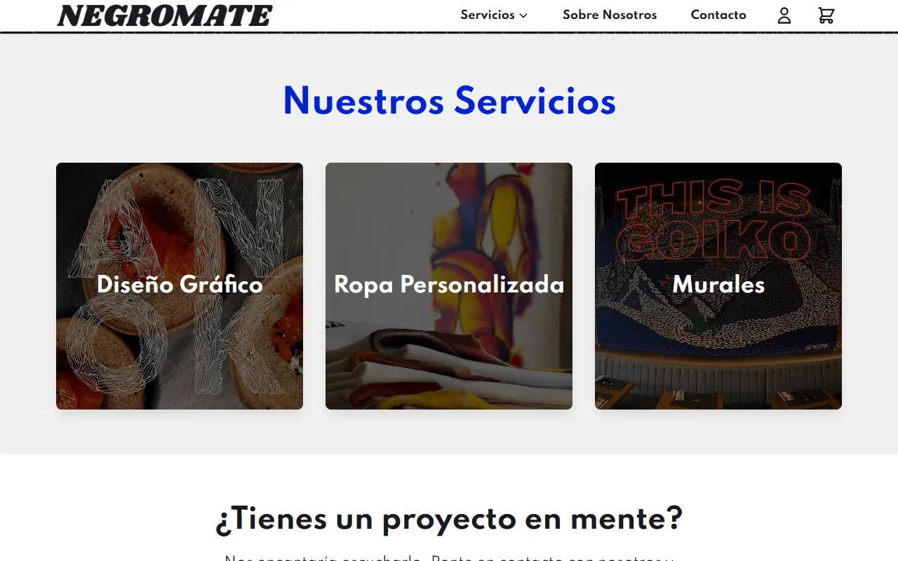
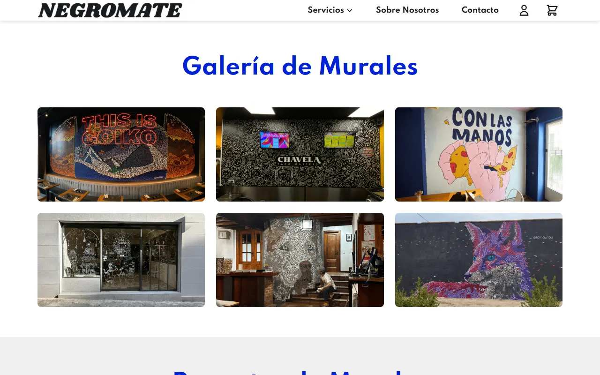
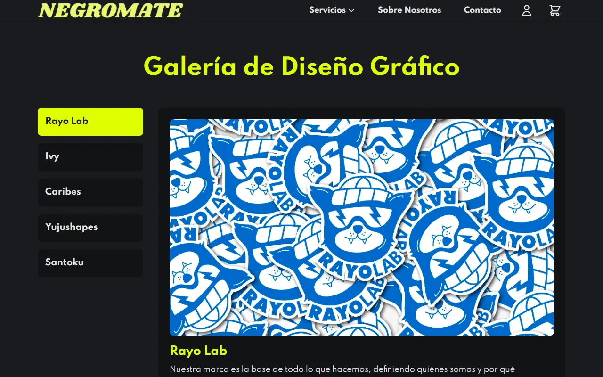
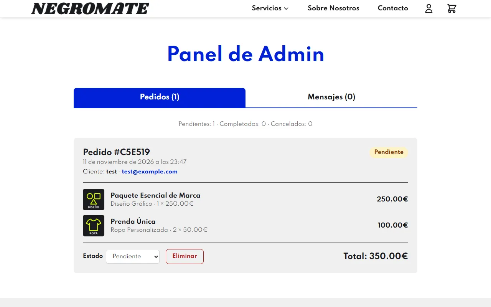
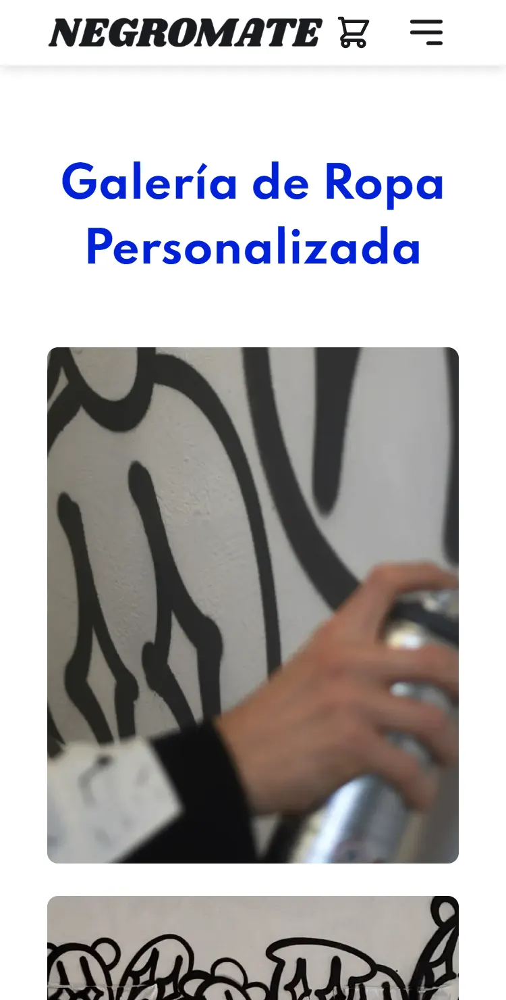
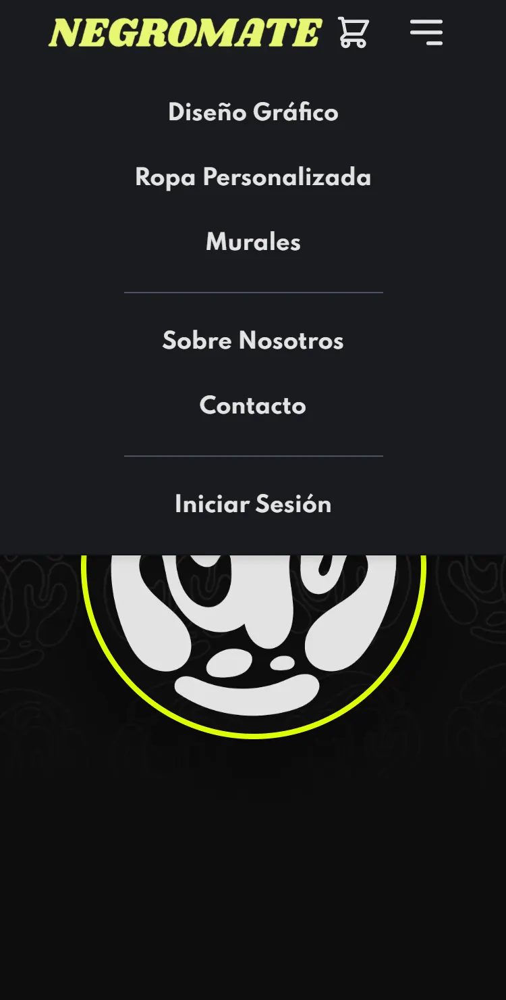

# Negromate

Web de **Negromate**, un estudio creativo de Madrid que hace diseño gráfico, ropa personalizada y murales.

Es un proyecto full stack: una web en **React** con galerías de trabajos, carrito de compras, registro de usuarios y panel de administración, conectada a una **API REST** propia hecha con **Node.js, Express y MongoDB**.

**[Ver la demo](https://negromate.vercel.app)**



## Funcionalidades

- Portada con los tres servicios del estudio.
- Galerías de Diseño Gráfico, Ropa Personalizada y Murales, con vista ampliada de las fotos.
- Paquetes de cada servicio con su precio y carrito de compras (se guarda en el navegador).
- Registro e inicio de sesión con JWT.
- **Mis Pedidos:** cada cliente ve sus pedidos y en qué estado están.
- **Panel de administración:** ver todos los pedidos, cambiar su estado o eliminarlos, y leer los mensajes de contacto.
- Formulario de contacto (los mensajes se guardan en la base de datos).
- Modo claro y modo oscuro.
- Diseño responsive para móvil, tablet y escritorio.

## Capturas

| Galería de Murales | Diseño Gráfico (modo oscuro) |
| :---: | :---: |
|  |  |
| **Panel de administración** | **Móvil** |
|  |   |

## Tecnologías

| Frontend | Backend |
| --- | --- |
| React 19 y React Router 7 | Node.js y Express 5 |
| Vite 7 | MongoDB Atlas con Mongoose |
| CSS | JWT y bcrypt |
| react-hot-toast | cors y dotenv |

Herramientas: Git, GitHub, ESLint, nodemon y REST Client (VS Code).

## Estructura

```text
negromate-proyecto/
├── backend/       API REST con Express (ver backend/README.md)
├── frontend/      Web con React (ver frontend/README.md)
└── screenshots/   Capturas de este README
```

## Cómo ejecutarlo en local

Necesitas **Node.js 20** o superior y una base de datos en [MongoDB Atlas](https://www.mongodb.com/atlas) (el plan gratuito sirve).

**1. Backend** (en una terminal):

```bash
cd backend
npm install
cp .env.example .env    # en Windows: copy .env.example .env
npm run create-admin    # crea un admin en tu base de datos
npm run dev             # API en http://localhost:3000
```

Antes de crear el administrador, rellena el `.env` con los datos de tu base de datos (están explicados en el [README del backend](backend/README.md#variables-de-entorno)). La primera vez que arranca, la API carga los paquetes y las galerías de ejemplo.

**2. Frontend** (en otra terminal):

```bash
cd frontend
npm install
cp .env.example .env    # en Windows: copy .env.example .env
npm run dev             # web en http://localhost:5173
```

## Lo que he aprendido

- Organizar una app de React en páginas y componentes, y compartir la sesión, el carrito y el tema con Context.
- Proteger rutas en React y en la API con JWT y dos roles (usuario y admin).
- Crear una API REST con Express y MongoDB, y responder a los errores desde un middleware.
- Calcular el total del pedido en el servidor, para que no se pueda cambiar el precio desde el navegador.
- Maquetar con CSS y media queries, empezando por el móvil, con modo oscuro usando variables CSS.

## Próximas mejoras

- Pago online de los pedidos.
- Emails de confirmación de pedidos y mensajes.
- Tests automáticos.
- Gestionar paquetes y fotos desde el panel de administración.

## Autor

**Alan Smallpage Machado**, desarrollador web

- GitHub: [@alansmallpage](https://github.com/alansmallpage)

Las imágenes, el logo y la marca Negromate pertenecen a sus autores.
